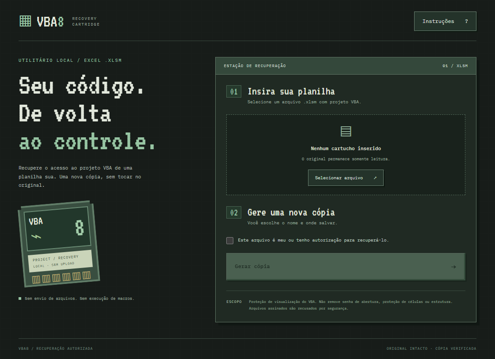
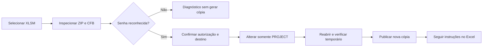

<div align="center">


# VBA8

### Seu código. De volta ao controle.

Recuperação local de acesso a projetos VBA em planilhas Excel `.xlsm`, com interface 8-bits, núcleo Rust e diálogos nativos do Windows.

[Como usar](#como-usar) · [Compilar](#compilar-a-partir-do-código) · [Documentação](#documentação) · [Limitações](#limitações-importantes)

</div>



> Use somente em arquivos seus ou para os quais você tenha autorização explícita. O VBA8 não descobre a senha original nem descriptografa documentos com senha de abertura.

## O que o aplicativo faz

O VBA8 identifica o projeto VBA de uma planilha, verifica se existe uma senha de projeto reconhecida e gera uma nova cópia para recuperação no editor VBA do Excel.

- Seleção de `.xlsm` por diálogo nativo.
- Inspeção antes de habilitar a geração da cópia.
- Destino escolhido em um diálogo de salvamento.
- Original aberto somente para leitura; destinos existentes são recusados.
- Processamento local, sem upload, conta, API ou execução de macros.
- Instruções integradas para os passos posteriores no Excel.
- Fontes e interface incluídas no executável, sem CDN.

## Como funciona

Um `.xlsm` é um pacote ZIP. Seu arquivo `xl/vbaProject.bin` é um contêiner CFB, não um bloco de texto simples.

O núcleo:

1. Valida extensão, pacote OOXML, nomes de entradas, limites e assinaturas conhecidas.
2. Interpreta o CFB e lê apenas o stream raiz `/PROJECT`.
3. Decodifica o campo DPB conforme MS-OVBA para distinguir senha presente do sentinela de ausência de senha. Encontrar `DPB` não basta: projetos sem senha também podem contê-lo.
4. No modo de compatibilidade implementado, renomeia `DPB` para `DPx`, alterando um byte e mantendo o comprimento do stream.
5. Grava um temporário, reabre a saída e verifica sua preservação antes de publicá-la sem sobrescrever um destino existente.

**Importante:** `DPx` é um workaround de compatibilidade, não uma propriedade canônica de remoção de senha. O Excel pode pedir passos adicionais, e o resultado varia entre versões do Office. A cópia verificada pelo aplicativo não equivale a desbloqueio confirmado no VBE.



## Como usar

### Requisitos para executar

- Windows x64. A validação local foi feita no Windows 11.
- Microsoft Edge WebView2 Runtime instalado.
- Excel desktop com editor VBA para a etapa posterior. O Excel não precisa estar instalado para o núcleo processar o arquivo.

### Passo a passo

1. Feche a planilha original no Excel e mantenha uma cópia de segurança.
2. Abra `VBA8.exe`.
3. Clique em **Selecionar arquivo** e escolha o `.xlsm`.
4. Confirme que o arquivo é seu ou que você tem autorização.
5. Clique em **Gerar cópia** e escolha um nome novo, sem sobrescrever o original.
6. Abra **Instruções** para concluir e verificar o procedimento no Excel.

O aplicativo não abre o Excel automaticamente. Não habilite macros de fontes desconhecidas.

### Por que uma senha temporária pode ser necessária?

O método invalida o nome de uma propriedade de proteção; ele não substitui a senha por uma senha conhecida. Dependendo do Office, o VBE pode apresentar um aviso e permitir acesso às propriedades. Nessa situação, definir uma senha temporária, salvar, fechar completamente o Excel, reabrir e depois remover o bloqueio pode normalizar o estado do projeto.

Algumas versões podem aceitar uma senha qualquer; outras não. **Não há garantia de que qualquer senha funcione.** Se as propriedades não ficarem acessíveis, pare e volte ao original. Consulte [o guia completo](docs/USAGE.md).

## Proteções de integridade

| Medida | Comportamento |
|---|---|
| Original | Não é gravado pelo processo de recuperação |
| Identidade do arquivo | Origem e destino iguais, inclusive hardlinks, são recusados |
| Saída existente | Nunca é sobrescrita pelo núcleo |
| Alvo da mudança | Somente o marcador da linha de proteção no stream raiz `/PROJECT` |
| VBA | Verificação exige exatamente um byte diferente no contêiner |
| Outros membros ZIP | Conteúdo comparado; entradas intocadas copiadas pelo caminho raw do ZIP |
| Publicação | Temporário no diretório de destino, verificação e `persist_noclobber` |
| Entradas malformadas | Duplicatas, caminhos inseguros e estruturas ambíguas são recusados |
| Assinaturas | Arquivos com assinaturas VBA/pacote reconhecidas são recusados por precaução |

Há limites de 1 GiB para arquivo/pacote expandido, 100 MiB para o VBA, 1 MiB para o texto PROJECT e limites adicionais de XML/entradas. Consulte o código do núcleo para a implementação exata.

## Limitações importantes

- Somente `.xlsm`; não oferece suporte a `.xls` legado, `.xlsb`, Word ou PowerPoint.
- Não remove senha de abertura/criptografia, proteção de células ou estrutura da pasta.
- Não recupera a senha original.
- Não executa, verifica a segurança ou garante a correção das macros.
- Não repara um arquivo já corrompido.
- Não garante compatibilidade do workaround com todas as versões do Excel.
- Não inclui instalador nem assinatura de código. Uma compilação sem assinatura pode provocar aviso do SmartScreen.
- Algumas mensagens técnicas de erro ainda estão em inglês.
- A interface foi exercitada com os diálogos nativos; a automação confirmou a gravação no destino sugerido, mas não certificou independentemente uma pasta arbitrária.

## Compilar a partir do código

### Ferramentas

- Rust estável com suporte à edição 2024, `cargo`, `rustfmt` e `clippy`.
- Node.js LTS compatível com Vite 7 e npm.
- Python 3.10+ para o script de build, sem pacotes Python adicionais.
- No Windows: Visual Studio Build Tools com ferramentas C++ e Windows SDK; WebView2 Runtime.

```powershell
git clone https://github.com/gustavczar/vba8.git
cd vba8
npm ci --prefix ui
python build.py
```

O script usa `cargo` e `npm` do PATH. Para instalações portáteis, defina `VBA8_CARGO` e `VBA8_NPM` com os caminhos completos. `CARGO_HOME` e `RUSTUP_HOME`, se necessários, seguem as variáveis normais do Rust.

Saída Windows: `desktop/target/release/vba8.exe`.

Não é preciso instalar Python ou Node para executar o EXE pronto. Eles são ferramentas de desenvolvimento.

[Guia de desenvolvimento](docs/DEVELOPMENT.md) · [Testes](docs/TESTING.md)

## Verificação realizada

Na validação local de desenvolvimento:

| Camada | Resultado observado |
|---|---|
| Núcleo Rust | 12 testes, incluindo uma integração opcional com três XLSM públicos protegidos |
| Interface | 7 testes Vitest/Testing Library |
| Adaptador desktop | 5 testes de sessão/configuração |
| Harness Windows | 10 testes auxiliares no ambiente local |
| GUI real | Seleção nativa, autorização e geração de uma cópia verificadas |
| Preservação independente | Original com SHA-256 intacto, um byte alterado no VBA e demais streams/membros preservados |
| Excel | Original e cópia abertos em somente leitura no Excel 16.0, build 20527, com macros desabilitadas e valores de planilha iguais |

**Ainda não validado:** ciclo completo de desbloqueio, salvamento e reabertura no editor VBA. Abrir a planilha no Excel não prova que o VBE está desbloqueado.

As fixtures externas e os relatórios locais não fazem parte do código versionado. A suíte padrão não baixa planilhas nem abre o Office. O workflow do GitHub é uma verificação separada; seu resultado deve ser consultado em Actions, não inferido da execução local.

## Por que Rust + Tauri?

Tauri usa o WebView2 compartilhado no Windows. Electron distribui Chromium e Node junto com o aplicativo. Para este utilitário local, Tauri foi escolhido para reduzir o conteúdo distribuído no pacote específico do app.

Uma compilação local inicial teve 3.875.840 bytes (~3,70 MiB), **sem incluir o WebView2**. Isso não é benchmark de RAM ou startup contra Electron. Empacotar um runtime WebView2 offline aumenta significativamente a distribuição.

## Estrutura

```text
core/          Núcleo Rust independente e CLI
  src/         Inspeção, patch e preservação do pacote
  tests/       Testes sintéticos e integração opcional
ui/            React + TypeScript + Vite + Tailwind
  src/         Interface 8-bits e instruções
desktop/       Adaptador Tauri e diálogos nativos
docs/          Uso, arquitetura, testes e segurança
tests/         Testes do script de build
.github/       Workflow de verificação Windows
```

## Documentação

- [Guia de uso e instruções Excel](docs/USAGE.md)
- [Arquitetura e decisões técnicas](docs/ARCHITECTURE.md)
- [Ambiente de desenvolvimento](docs/DEVELOPMENT.md)
- [Testes, evidências e limites](docs/TESTING.md)
- [Política de segurança](SECURITY.md)
- [Dependências e avisos de terceiros](THIRD_PARTY_NOTICES.md)
- [Histórico de alterações](CHANGELOG.md)

## Autoria e direitos

Criado por **Gustavo Cezar Lourenço** — [@gustavczar](https://github.com/gustavczar).

Todos os direitos reservados sobre o código próprio, salvo autorização expressa do titular. Não foi concedida uma licença open source para o conjunto do projeto. Dependências e materiais de terceiros mantêm suas respectivas licenças; consulte [LICENSE](LICENSE) e [THIRD_PARTY_NOTICES.md](THIRD_PARTY_NOTICES.md).
