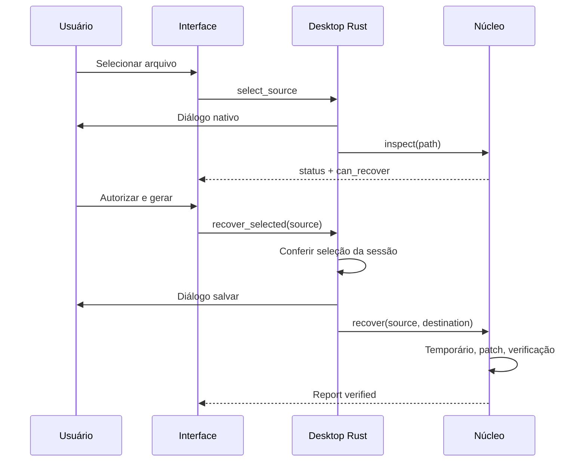

# Arquitetura

## Componentes

O projeto usa três unidades pequenas, sem servidor ou banco de dados:

- `core`: biblioteca Rust e CLI, independentes da janela.
- `desktop`: Tauri, estado de sessão e diálogos nativos.
- `ui`: React/TypeScript, estados de interação e instruções locais.

## Localização antes da alteração

O núcleo não faz uma busca cega de DPB no `vbaProject.bin` inteiro. Usa a biblioteca CFB para resolver o stream raiz `/PROJECT`, analisa a linha de proteção e recusa ocorrências ambíguas. A decodificação MS-OVBA diferencia a ausência de senha de campos malformados. Bytes decodificados não são expostos como senha recuperada.

`DPB → DPx` é deliberadamente um modo de compatibilidade de um byte. Não é uma serialização canônica de um projeto sem proteção. Este escopo reduz a superfície de alteração, mas transfere ao VBE uma etapa posterior dependente da versão do Office.

## Gravação

1. Origem somente leitura e identidade do destino validada.
2. Assinaturas reconhecidas e pacotes inseguros recusados.
3. CFB alterado em memória e delta validado.
4. Membros não alvo copiados por raw-copy; membro VBA regravado.
5. Temporário criado no diretório de destino.
6. Conteúdo e metadados relevantes comparados após reabertura.
7. Publicação sem sobrescrita com `persist_noclobber`.

Não há promessa de preservação byte a byte do ZIP inteiro: estruturas e offsets do pacote podem mudar. O contrato de preservação se refere ao conteúdo e às verificações implementadas, com um byte de diferença no contêiner VBA.

## IPC e interface

Somente dois comandos próprios estão expostos: `select_source` e `recover_selected`. O backend mantém a seleção nativa da sessão e um guard contra operações concorrentes. O processamento e os diálogos são executados fora da thread principal por `spawn_blocking`.

A UI não recebe acesso genérico a shell ou filesystem. A CSP restringe recursos ao aplicativo e IPC. Fontes são empacotadas localmente. O runtime WebView2 ainda precisa de atualizações do sistema; local não significa imune a falhas de parsing.

## Decisão: Tauri versus Electron

Tauri utiliza o WebView2 compartilhado no Windows; Electron incorpora Chromium e Node. A decisão foi reduzir o pacote distribuído para este utilitário. Não foi realizado benchmark comparável de RAM/startup. O runtime compartilhado não está incluído no tamanho do EXE.

## Referências

- [MS-OVBA](https://learn.microsoft.com/en-us/openspecs/office_file_formats/ms-ovba/)
- [MS-CFB](https://learn.microsoft.com/en-us/openspecs/windows_protocols/ms-cfb/)
- [Tauri process model](https://v2.tauri.app/concept/process-model/)
- [Electron process model](https://www.electronjs.org/docs/latest/tutorial/process-model)

As referências são documentação de formatos e arquitetura; não são alegações de endosso dos respectivos projetos.
